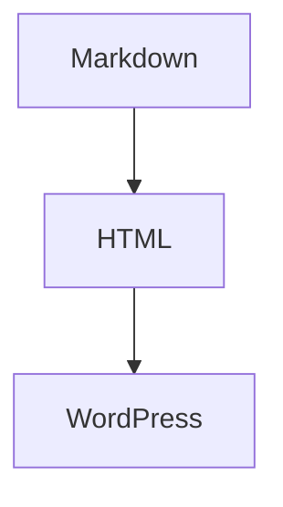

# Markdown 記事の投稿手順

WordPress の標準エディターを維持したまま、Markdown 原稿を HTML に変換して投稿する手順です。Markdown 変換はローカルで行い、WordPress プラグインや本番環境への追加設定は不要です。

## 画像

1. `manage.ka2.org` のメディアライブラリに画像をアップロードします。
2. 画像 URL をコピーし、Markdown に HTTPS URL として記述します。

```md

```

画像を投稿原稿と同じフォルダーに置いただけでは公開されません。変換コマンドは相対パス画像をエラーにして、先にメディアライブラリへアップロードするよう案内します。Cloudflare Pages の `/assets/` 配信は現在の設定で `manage.ka2.org` にプロキシされるため、R2 への移管なしで画像を表示できます。

## Mermaid 図

Markdown の fenced code block に `mermaid` を指定します。

````md

````

変換後も Mermaid コードとして保持されます。記事ページを開いたときに限り、フロントエンドが描画ライブラリを遅延読み込みして SVG 図を表示します。JavaScript は初回表示時に必要なチャンクだけ取得・キャッシュされるため、Mermaidを使わない訪問者は図の描画コードを取得しません。JavaScript が無効の場合や図の記法に誤りがある場合は、元のコードを表示します。

## 変換して投稿

Node.js と pnpm が利用できる環境で、`frontend/` に移動して実行します。入力 Markdown は UTF-8 で保存してください。変換コマンドは UTF-8 として厳密に読み込み、UTF-8 以外のファイルはエラーにします。BOM 付き UTF-8 も読み込めます。変換後の HTML は UTF-8 (BOM なし)でファイルに保存できます。

```bash
pnpm --silent markdown:html -- "/c/path/to/article.md" --output "/c/path/to/article.html"
```

Git Bash でクリップボードへコピーする場合は、まず UTF-8 HTML ファイルを生成し、PowerShell にそのファイルを UTF-8 として読み込ませます。HTML を直接 `clip.exe` へパイプすると文字コードの解釈が環境依存になり、文字化けする場合があります。

```bash
pnpm --silent markdown:html -- "/c/path/to/article.md" --output "/c/path/to/article.html"
powershell.exe -NoProfile -Command "Get-Content -Raw -Encoding UTF8 'C:\path\to\article.html' | Set-Clipboard"
```

PowerShell で実行する場合は、Windows形式のパスを指定できます。

```powershell
pnpm --silent markdown:html -- "C:\path\to\article.md" --output "C:\path\to\article.html"
Get-Content -Raw -Encoding UTF8 "C:\path\to\article.html" | Set-Clipboard
```

`--` は pnpm からスクリプトへ引数を渡す区切りとして処理されます。スクリプト側もこの区切りを受け取れるため、ファイルパスが `--` と誤認されません。WordPress の投稿編集画面で「カスタム HTML」ブロックを追加し、HTML を貼り付けます。タイトル、カテゴリ、アイキャッチ画像などは通常どおり WordPress の各フィールドで設定し、プレビューで表示を確認してから公開します。

変換結果を確認したい場合は、クリップボードへ送らずに実行します。

```powershell
pnpm --silent markdown:html -- "C:\path\to\article.md"
```

標準出力も UTF-8 です。Git Bash では、`/c/path/to/article.md` のようなパスを指定してください。クリップボードにコピーする場合は、文字コード変換を避けるため `--output` でファイルへ保存してから PowerShell の `Get-Content -Encoding UTF8` を使ってください。

Markdown の見出し、リスト、リンク、画像、コードフェンスを HTML に変換します。入力した raw HTML は無効化されます。変換後の HTML は WordPress 固定ページや投稿の「カスタム HTML」ブロックで使用してください。
